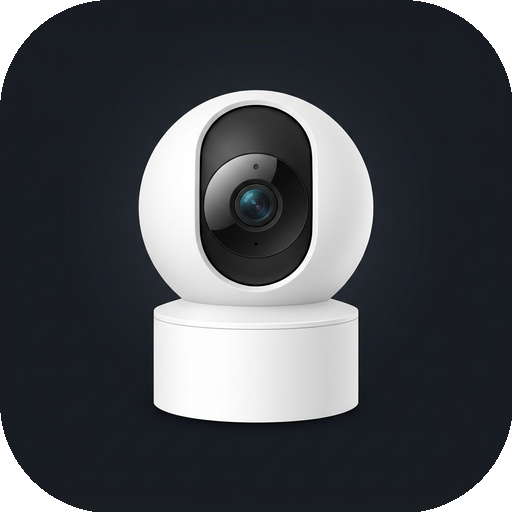
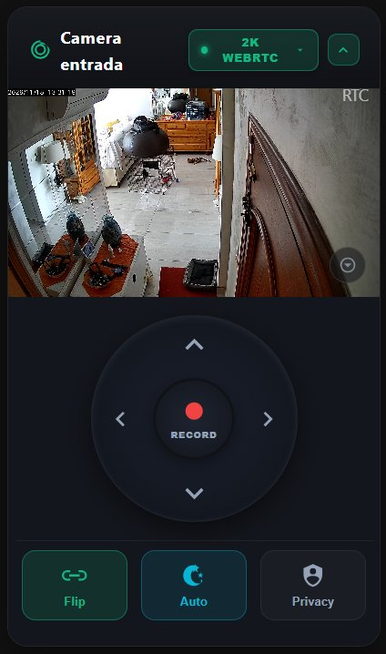
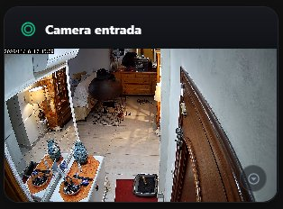
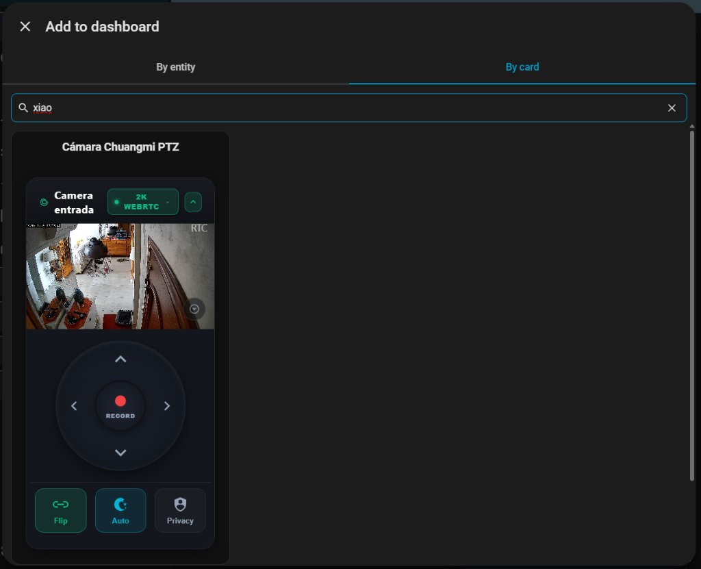
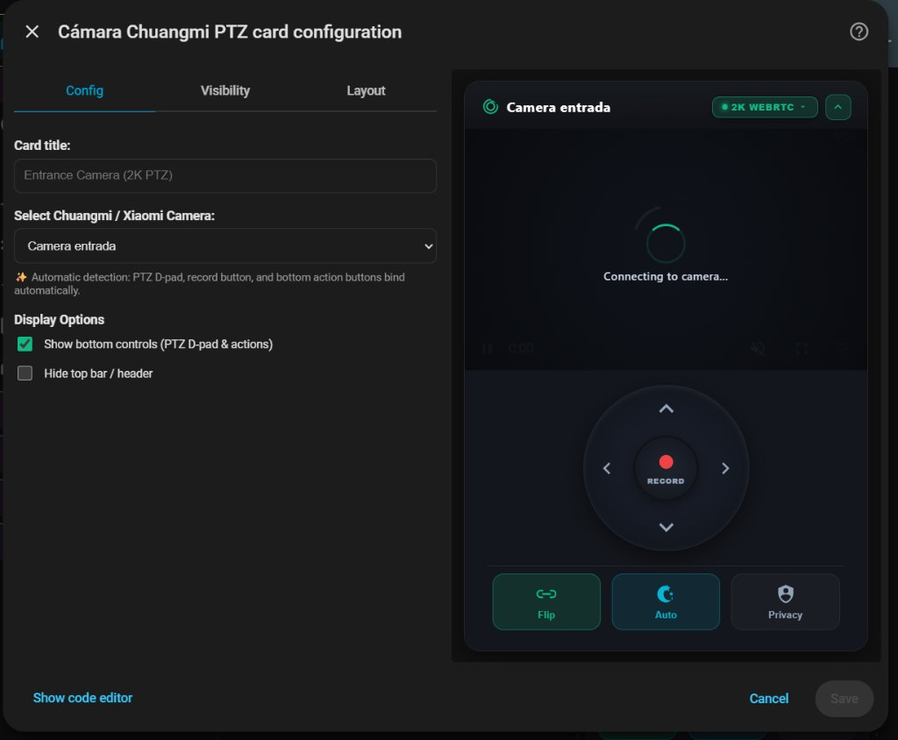
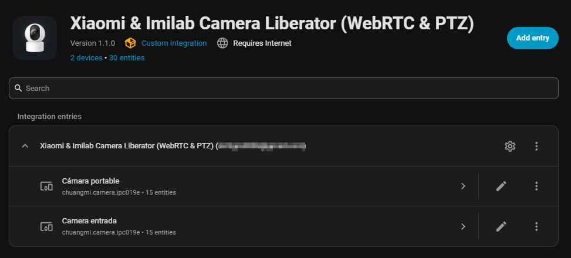
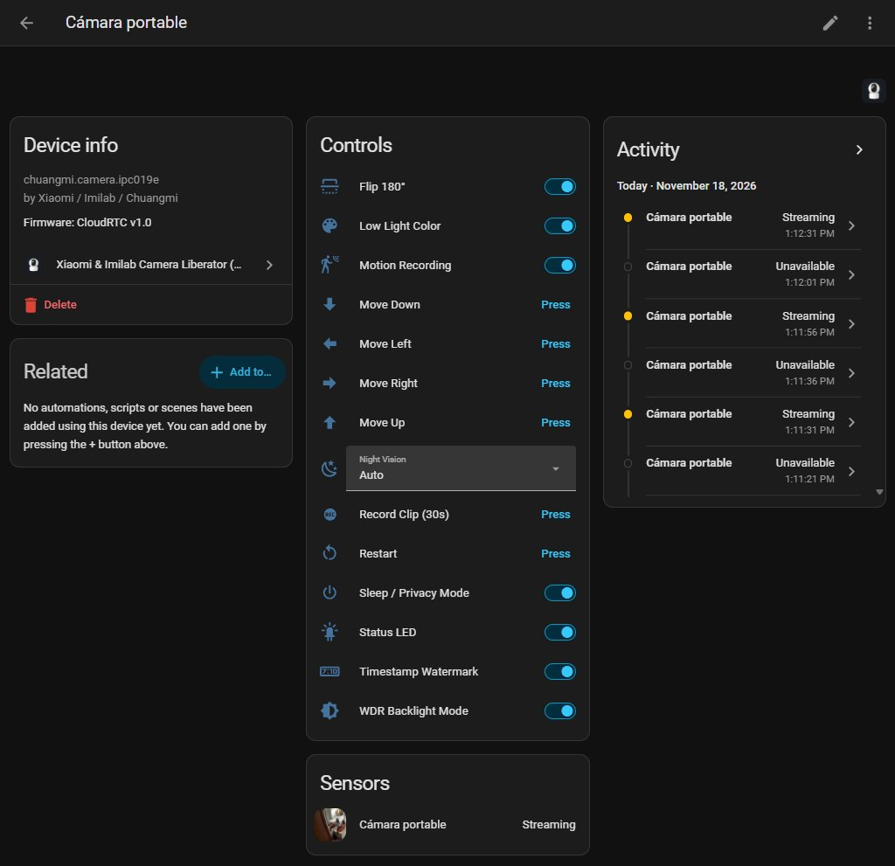
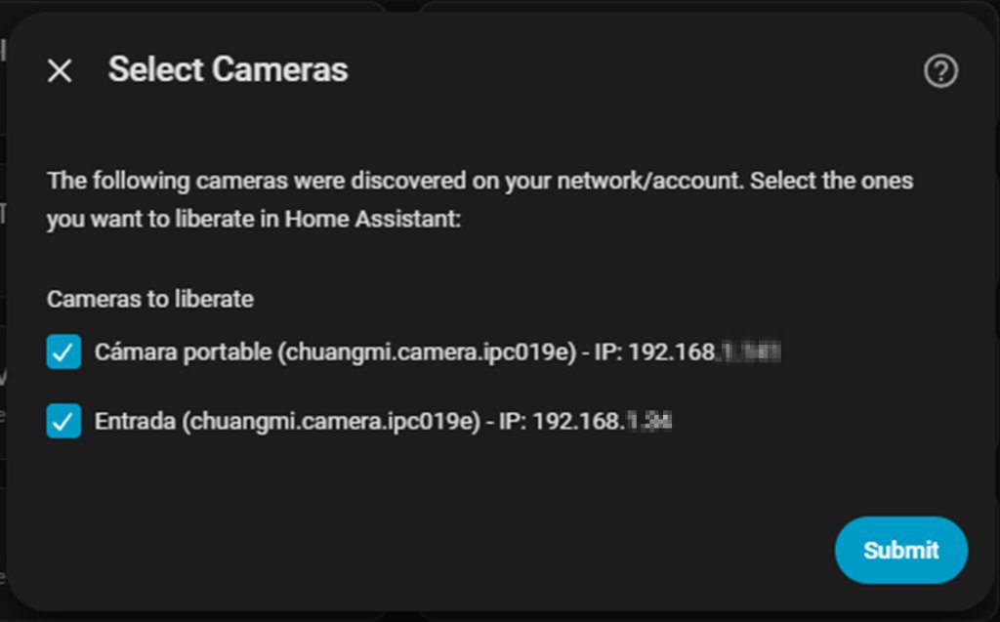
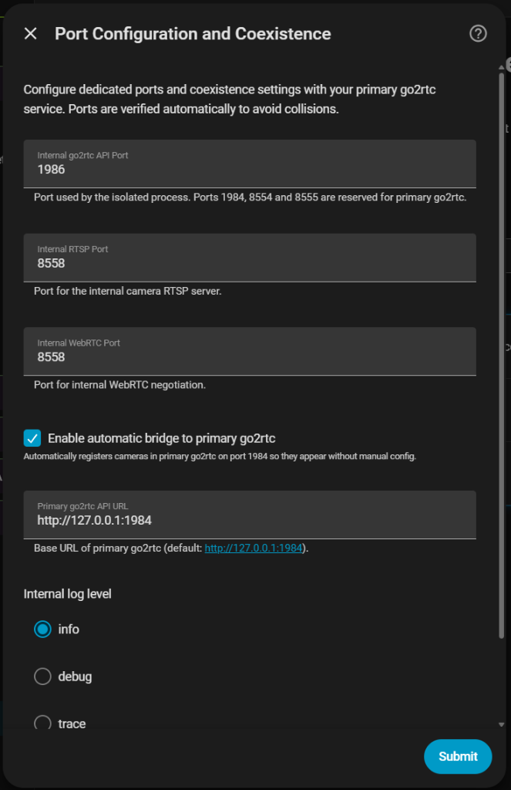
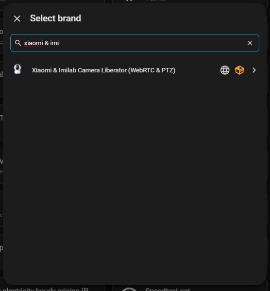

<p align="center">
  
</p>

<div align="center">
  <h1>Xiaomi & Imilab Camera Liberator (WebRTC & PTZ)</h1>

  [](https://github.com/hacs/default)
  [](https://www.home-assistant.io/)
  [](https://github.com/AlexxIT/go2rtc)
  [](https://github.com/VictorCV-DAM/ha-xiaomi-imilab-camera-liberator-webrtc/releases)
  [](https://github.com/VictorCV-DAM/ha-xiaomi-imilab-camera-liberator-webrtc/releases)
  [](https://github.com/VictorCV-DAM/ha-xiaomi-imilab-camera-liberator-webrtc/blob/main/LICENSE)
  
  [](https://buymeacoffee.com/VictorCV)
  [](https://paypal.me/victorcava)
  [](https://ko-fi.com/victorcv)
</div>

<p align="center">
  <strong>🔓 The Ultimate Liberation for Xiaomi, Chuangmi & Imilab Cameras in Home Assistant</strong><br>
  <strong>Brings Full Local Control & Ultra-Low Latency 2K WebRTC to Long-Unsupported Hardware:</strong><br>
  <strong>Xiaomi Smart Camera 2K / Imilab A1</strong> (<code>ipc019e</code> / <code>ipc019</code>) • <strong>Mijia 360° PTZ 1080P</strong> (<code>ipc009</code> / <code>xiaobai</code>) • <strong>Xiaomi C200 / C300 / C400 / C500 Pro</strong> (<code>026c02</code>, <code>046c04</code>, <code>055a01</code>, <code>069a01</code>) • <strong>Chuangmi IP v2–v6 / PTZ Pro</strong> (<code>ipc013</code>, <code>ipc020</code>–<code>022</code>) • <strong>Imilab C20 / C21 / C30</strong>
</p>

<p align="center">
  <em>After years without native local support or RTSP firmware, this integration completely liberates a vast fleet of Xiaomi / Chuangmi / Imilab cameras with <strong>instant &lt;200ms 2K WebRTC streaming</strong>, <strong>in-card quick video recording</strong>, <strong>100% local UDP PTZ motor control</strong>, and a dedicated tactile Lovelace PTZ card — <strong>zero cloud subscriptions, zero hacking, zero cloud lag</strong>.</em>
</p>

---

## 📦 Installation via HACS

[](https://my.home-assistant.io/redirect/hacs_repository/?owner=VictorCV-DAM&repository=ha-xiaomi-imilab-camera-liberator-webrtc&category=integration)

### ⚡ 1-Click Fast Install
Click the badge above to open **Xiaomi & Imilab Camera Liberator (WebRTC & PTZ)** directly inside your Home Assistant HACS store, then click **Download**.

### 🛠️ Manual Custom Repository Setup
1. Open **HACS** in your Home Assistant sidebar.
2. Click the three dots (top right corner) and select **Custom repositories**.
3. Paste the repository URL:  
   `https://github.com/VictorCV-DAM/ha-xiaomi-imilab-camera-liberator-webrtc`
4. Set category to **Integration** and click **Add**.
5. Find **Xiaomi & Imilab Camera Liberator (WebRTC & PTZ)** in the list and click **Download**.
6. Restart Home Assistant (*Settings > System > Restart*).

---

## ⚡ Highlights & Key Features

- **⚡ Zero-Lag WebRTC Streaming (&lt;200ms):** Eliminates the annoying 2–5 second cloud latency and buffering of traditional HLS/RTSP streams. Streams directly via hardware-accelerated `go2rtc` and WebSocket peer negotiation.
- **🎥 Instant In-Card Video Recording:** Center record button (`RECORD` / `GRABAR`) records live video chunks directly from the browser with an active stopwatch timer (`● RECORDING 00:00`), automatically downloading the MP4/WebM video clip upon completion while triggering the camera's local 30s storage backup.
- **🎛️ Interactive Resolution Selector Badge:** Switch dynamically between **2K WEBRTC** (maximum native resolution), **HD 1080P** (high-efficiency fluid native stream), and **SD 360P** (lightweight mobile stream). User preferences are remembered and persisted per camera in local storage.
- **🎮 Tactile Lovelace PTZ Card (`chuangmi-ptz-card`):**
  - Responsive circular directional D-pad (Up, Down, Left, Right) with hardware gear debouncing.
  - **Ceiling / Inversion Awareness:** Pressing Up moves the camera visually upward regardless of 0° or 180° inverted ceiling mounting.
  - Streamlined 3-action bottom bar: **Flip 180°**, **Night Vision**, and **Privacy / Sleep Mode**.
  - **Entity Details on Click:** Clicking the camera title in the card header opens Home Assistant's native entity/device dialog (`more-info`).
  - **Seamless Bilingual Localization:** Automatically switches between English and Spanish matching your Home Assistant profile language.
- **🛡️ 100% Local UDP Controls:** Controls PTZ motor, night mode, status LED, sleep mode, timestamp watermark, and motion recording directly over local network (miIO protocol).
- **🔄 Dynamic Fleet Discovery:** Automatically finds all your Xiaomi cameras on reload without needing manual IP or token re-entry.
- **📦 Zero-Configuration Binary Management:** Automatically verifies, isolates, and bridges with any existing primary `go2rtc` service on port 1984 without port collisions.

---

## 📸 Lovelace PTZ Card (`chuangmi-ptz-card`)

The integration includes a dedicated, highly customizable Lovelace card with both a full PTZ control interface and an edge-to-edge minimalist collapsed mode:

<div align="center">
  <p align="center">
    
    &nbsp;&nbsp;
    
  </p>
</div>

### 🖱️ 100% GUI Setup via Pre-Made Card Picker (Zero YAML Required)

You do **not** need to write or copy any manual YAML code! The integration automatically registers `chuangmi-ptz-card` into Home Assistant's native dashboard card catalog with a complete visual configuration editor:

<div align="center">
  <p align="center">
    
    &nbsp;&nbsp;
    
  </p>
</div>

1. Open any Home Assistant dashboard, click the **three dots `⋮`** (top right) ➔ **Edit Dashboard**.
2. Click **+ Add Card** at the bottom.
3. Switch to the **By card** tab and search for `"Chuangmi"` or `"Xiaomi"`.
4. Click on **Cámara Chuangmi PTZ** in the pre-made cards list.
5. **✨ Automatic Entity Discovery & Binding:** Pick your camera from the dropdown menu in the interactive visual editor. The card automatically detects and connects:
   - Live WebRTC 2K video stream
   - Tactile PTZ directional D-pad
   - In-browser live recording button
   - 180° image inversion toggle
   - 3-state Night Vision IR switcher
   - Sleep / Privacy standby switch
6. **🎛️ Live Visual Customization:** Toggle display options (show/hide PTZ D-pad and bottom actions, or hide the top header for a clean edge-to-edge video look) with instant side-by-side live preview before saving.

<details>
<summary><strong>⚙️ Advanced Manual YAML Configuration (Optional)</strong></summary>

For custom dashboards or advanced YAML mode, you can also define the card manually:

```yaml
type: custom:chuangmi-ptz-card
camera_entity: camera.camera_entrada_camera_123456789
title: Front Entrance (2K PTZ)
```
</details>

### Card Features:
| Feature | Description |
| :--- | :--- |
| **WebRTC 2K / HD Live** | Instant frame playback without buffering or keyframe lag |
| **Resolution Badge** | Toggle between 2K WEBRTC, HD 1080P, and SD 360P with persistent memory |
| **PTZ D-Pad** | Motor commands with hardware debouncing to prevent packet collisions |
| **Instant Video Record** | Record live video clips with real-time timer directly from your dashboard |
| **Flip 180°** | Toggle image orientation for ceiling or upside-down mounts |
| **Night Vision** | Cycle through Auto, Night Vision, and Off |
| **Privacy Mode** | Instant local sleep / standby mode |
| **Header More-Info** | Tap the title to open native device settings and controls |
| **Pre-Made Card Picker** | Add directly from Home Assistant's visual GUI card library |

---

## 🖼️ Screenshots & Real-World UI

<div align="center">
<table align="center" style="margin: 0 auto; text-align: center; border-collapse: collapse;">
  <tr align="center">
    <td align="center" width="50%" style="padding: 12px; text-align: center;">
      <strong>Multi-Device Fleet & Entities (v1.1.0)</strong><br><br>
      
    </td>
    <td align="center" width="50%" style="padding: 12px; text-align: center;">
      <strong>15+ Onboard Hardware Controls & Diagnostics</strong><br><br>
      
    </td>
  </tr>
  <tr align="center">
    <td align="center" width="50%" style="padding: 12px; text-align: center;">
      <strong>Automatic Local Fleet Discovery</strong><br><br>
      
    </td>
    <td align="center" width="50%" style="padding: 12px; text-align: center;">
      <strong>Port Isolation & go2rtc Coexistence</strong><br><br>
      
    </td>
  </tr>
  <tr align="center">
    <td align="center" width="50%" style="padding: 12px; text-align: center;">
      <strong>Brand Search in Home Assistant</strong><br><br>
      
    </td>
    <td align="center" width="50%" style="padding: 12px; text-align: center;">
      <strong>Lovelace Pre-Made Card Picker</strong><br><br>
      
    </td>
  </tr>
  <tr align="center">
    <td align="center" width="50%" style="padding: 12px; text-align: center;">
      <strong>Visual Card Editor & Live Preview</strong><br><br>
      
    </td>
    <td align="center" width="50%" style="padding: 12px; text-align: center;">
      <strong>Edge-to-Edge Stream (Collapsed View)</strong><br><br>
      
    </td>
  </tr>
</table>
</div>

---

## 🛠️ Supported Hardware & Compatibility Matrix

This integration communicates via the native **Xiaomi MISS / CloudRTC** streaming protocol and direct **miIO UDP** local sockets. Below is the complete list of tested and potentially compatible cameras across the Xiaomi / Chuangmi / Imilab ecosystem:

### 1. Tested & Verified Working (Production Ready)

| Model Identifier | Commercial Name | Resolution | WebRTC Live | Local PTZ | Local miIO | Status |
| :--- | :--- | :---: | :---: | :---: | :---: | :---: |
| `chuangmi.camera.ipc019e` | **Xiaomi Smart Camera 2K / Imilab A1 (CMSXJ19E)** | 2304x1296 (2K) | ✅ | ✅ | ✅ | **Verified Working** |

> **Verification Details:** Confirmed with dual-camera live setup. Instant PTZ response, real-time WebRTC stream (&lt;200ms latency), instant video recording, night vision IR switching, and local sleep/privacy toggle all operating flawlessly.

---

### 2. High-Confidence Architecture Match (Same Protocol & miIO Engine)

These models share the identical Chuangmi/Imilab firmware base, MISS streaming protocol, and miIO motor schemas:

| Model Identifier | Commercial Name | Resolution | Form Factor | PTZ Motor | Expected Compatibility |
| :--- | :--- | :---: | :---: | :---: | :---: |
| `chuangmi.camera.ipc019` | Imilab Home Security Camera A1 (Global/CN) | 1080p / 2K | Dome PTZ | ✅ | 🟢 High (Identical Chipset) |
| `chuangmi.camera.ipc009` | Xiaomi Mijia Smart Camera 1080P PTZ | 1080p | Dome PTZ | ✅ | 🟢 High |
| `chuangmi.camera.026c02` | Xiaomi Smart Camera C300 (XMC01) | 2K (1296p) | Dome PTZ | ✅ | 🟢 High |
| `chuangmi.camera.046c04` | Xiaomi Smart Camera C400 | 2.5K (1440p) | Dome PTZ | ✅ | 🟢 High |
| `chuangmi.camera.055a01` | Xiaomi Smart Camera C200 | 1080p | Dome PTZ | ✅ | 🟢 High |
| `chuangmi.camera.069a01` | Xiaomi Smart Camera C500 Pro / C500 | 3K (5MP) | Dome PTZ | ✅ | 🟢 High |
| `chuangmi.camera.ipc013` | Chuangmi Smart Camera 1080P Basic | 1080p | Fixed | ❌ | 🟢 High (Fixed View) |
| `chuangmi.camera.xiaobai`| Xiaomi Mijia 360° Smart Camera v1 | 720p / 1080p | Dome PTZ | ✅ | 🟢 High |
| `chuangmi.camera.ipc020` | Chuangmi Smart PTZ Camera Pro | 2K | Dome PTZ | ✅ | 🟢 High |
| `chuangmi.camera.ipc021` | Chuangmi Smart PTZ Camera Plus | 2.5K | Dome PTZ | ✅ | 🟢 High |
| `chuangmi.camera.ipc022` | Chuangmi Smart PTZ Camera 3 | 3K | Dome PTZ | ✅ | 🟢 High |
| `chuangmi.camera.v2`..`v6`| Chuangmi IP Camera Series (v2, v3, v4, v5, v6) | 720p / 1080p | Fixed / PTZ | Model-dep. | 🟢 High |

---

### 3. Potentially Compatible Models (Community Testing Requested)

| Model Identifier | Commercial Name | Resolution | Form Factor | Notes |
| :--- | :--- | :---: | :---: | :--- |
| `imilab.camera.006c01` | Imilab C20 / C21 | 1080p / 2.5K | Dome PTZ | Uses Imilab MISS stack |
| `imilab.camera.007c01` | Imilab C30 | 2.5K | Dome PTZ | Dual-band Wi-Fi variant |
| `isa.camera.isc5` | Xiaomi Outdoor Camera AW200 | 1080p | Fixed Outdoor | Local miIO + MISS |
| `isa.camera.hlc7` | Xiaomi Smart Camera PTZ Pro | 2K | Dome PTZ | Isaac firmware variant |

> 💡 **Have a different model?** If you have tested another Chuangmi, Imilab, or Xiaomi camera model with this integration, please [open a GitHub Issue](https://github.com/VictorCV-DAM/ha-xiaomi-imilab-camera-liberator-webrtc/issues) to report your results and help expand the verified list!

---

## 🧩 Entities Created per Camera

| Domain | Entity | Description |
| :--- | :--- | :--- |
| `camera` | `Live Camera` | WebRTC live video & snapshot provider |
| `button` | `Move Up / Down / Left / Right` | Direct local PTZ motor directional control |
| `button` | `Restart` | Soft restart of onboard camera daemons |
| `button` | `Record Clip (30s)` | Trigger instant 30-second on-camera recording |
| `switch` | `Flip 180°` | Invert image for ceiling mount |
| `switch` | `Sleep / Privacy Mode` | Toggle standby privacy mode |
| `switch` | `Status LED` | Enable or disable the blue front LED |
| `switch` | `Timestamp Watermark` | Toggle on-screen date & time display |
| `switch` | `WDR Backlight Mode` | Wide dynamic range backlight enhancement |
| `switch` | `Low Light Color` | Color night vision in low ambient light |
| `switch` | `Motion Recording` | Toggle automatic motion-triggered SD recording |
| `select` | `Night Vision` | Night vision IR mode (Auto / Always On / Off) |

---

## 🔍 How It Works Under the Hood

```
+-------------------------------------------------------------+
|                     Home Assistant UI                       |
|   +-----------------------------------------------------+   |
|   |         Chuangmi PTZ Card (chuangmi-ptz-card)       |   |
|   +-----------------------------------------------------+   |
+-----------------▲-------------------------▲-----------------+
                  │ WebRTC Video (2K / HD)  │ UDP miIO (PTZ)
                  │ In-Browser Recording    │
+-----------------▼-------------------------▼-----------------+
|               go2rtc                | Chuangmi Liberator    |
|   (Native Xiaomi Miss / WebRTC)     | Integration Engine    |
+-----------------▲-------------------------------------------+
                  │ Xiaomi stream protocol
+-----------------▼-------------------------------------------+
|               Chuangmi / Imilab Camera (LAN)                |
+-------------------------------------------------------------+
```

1. **Video Path:** WebRTC frames stream peer-to-peer directly between `go2rtc` and your browser/app for &lt;200ms latency. The card supports instantaneous quality toggling (2K / HD / SD).
2. **Control Path:** PTZ moves and switch commands are transmitted directly via UDP packets using miIO AES-CBC encryption without internet roundtrips.

---

## ☕ Support & Donations

If you appreciate this free, open-source integration and want to support its ongoing development, feel free to buy me a coffee:

[](https://buymeacoffee.com/VictorCV)
[](https://paypal.me/victorcava)
[](https://ko-fi.com/victorcv)

---

## 📄 License

This project is licensed under the **MIT License** - 100% open-source and free for the community. See [LICENSE](LICENSE) for details.
